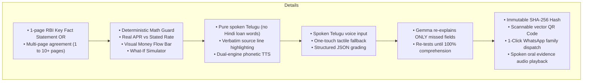
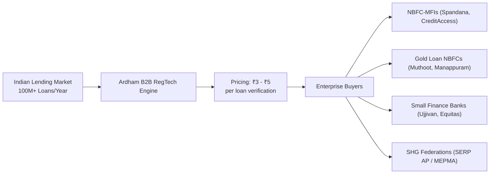

# 🏆 ARDHAM (అర్థం) — Comprehensive Hackathon Pitch, Technical Reference & Jury Defense Guide
> **Event**: Hacktoberfest Hack Day Vizag x AI for Vizag (MLH)  
> **Prize Tracks**: 
> 1. **Best Use of Gemma 4** (Primary Google Track)  
> 2. **Best Open-Source AI Project** (Secondary Track)  
> **Repository**: [https://github.com/gurusaiss/ardham](https://github.com/gurusaiss/ardham)  
> **License**: Apache-2.0

---

## 📑 TABLE OF CONTENTS
1. [Executive Summary & The 60-Second Hook](#1-executive-summary--the-60-second-hook)
2. [The Real-World Crisis: Why Ardham Exists](#2-the-real-world-crisis-why-ardham-exists)
3. [The Solution: How Ardham Works (End-to-End Flow)](#3-the-solution-how-ardham-works-end-to-end-flow)
4. [The 4 Modalities of Gemma 4 in Production](#4-the-4-modalities-of-gemma-4-in-production)
5. [The Hallucination Guard: Our Core Technical Moat](#5-the-hallucination-guard-our-core-technical-moat)
6. [Unique Breakthrough Features (The "Wow" Factors)](#6-unique-breakthrough-features-the-wow-factors)
7. [Tough Jury Q&A & Objection Handling](#7-tough-jury-qa--objection-handling)
8. [Ardham vs. ChatGPT / General LLMs](#8-ardham-vs-chatgpt--general-llms)
9. [Business Model: Who Buys & Market Viability](#9-business-model-who-buys--market-viability)
10. [The Winning 3-Minute Pitch Script (Word-for-Word)](#10-the-winning-3-minute-pitch-script-word-for-word)

---

## 1. Executive Summary & The 60-Second Hook

### The Hook (Memorize This for Judges):
> *"Judges, look at this loan card. To you and me, it looks like a standard ₹50,000 loan at 18% interest.  
> But to an illiterate rural woman or an elderly borrower in a village with zero 4G network, this is a financial trap.  
> Because the bank deducted ₹2,350 in upfront fees, the **Real Effective APR is actually 28.6%** — and missing 2 payments triggers the auction of her mother's gold without a court order.  
>  
> **Ardham (అర్థం)** is an on-device, offline-first AI shield powered by **Gemma 4**. It runs on a laptop with **Wi-Fi turned completely OFF**, translates the fine print into pure mother-tongue Telugu speech, tests the borrower's oral comprehension, and seals the loan with a tamper-proof **SHA-256 cryptographic audit certificate** before a single rupee is disbursed."*

---

## 2. The Real-World Crisis: Why Ardham Exists

### 1. The Historical Context:
- **The Andhra Pradesh Microfinance Crisis (2010)**: Over 200 rural women and farmers tragically took their lives due to hidden compounding interest rates, coercive weekly collections, and predatory penalties disguised as "small weekly payments of ₹600".
- **The Modern Scale**: Over **12 Crore (120 million) rural borrowers** take microfinance, gold, or Kisan credit loans in India every year.
- **The Literacy Gap**: Over **70% of rural microfinance borrowers cannot read English or financial legal documents**. Today, a loan agreement is signed when a field officer points their thumb to an inkpad. **There is zero legal proof the borrower understood the terms.**

### 2. The Regulatory Mandate (Why Now?):
- **RBI Digital Lending Guidelines (2022)** & **Microfinance Fair Practices Code (2023)**.
- **RBI Circular RBI/2023-24/139 (April 2024 Mandate)**: RBI legally mandates that lenders provide a standardized 1-page **Key Fact Statement (KFS)** and ensure borrowers comprehend the Annual Percentage Rate (APR), penal interest, and recovery clauses before disbursement.
- **The Regulatory Pain**: In 2023–2024, the RBI levied **over ₹100 Crores in fines** against major NBFCs and banks (e.g., Bajaj Finance, Bank of Baroda) for misleading loan disclosures.

---

## 3. The Solution: How Ardham Works (End-to-End Flow)



---

## 4. The 4 Modalities of Gemma 4 in Production

We do not use Gemma 4 as a toy chatbot. **Gemma 4 powers every operational step**:

| Modality | What Gemma 4 Does | Where in the Code |
| :--- | :--- | :--- |
| **1. Vision** | Reads photographed multi-page loan cards (1 to 10+ pages), extracting 11 fields (`loan_amount`, `interest_rate`, `instalments`, `penalties`) with exact verbatim `source_text` citations and confidence scores. | `backend/extract.py` |
| **2. Multilingual** | Synthesizes complex financial legalese into simple, natural, pure regional Telugu (**ఆంధ్ర/తెలంగాణ వాడుక భాష**), strictly quoting verbatim text so numbers are never invented. | `backend/explain.py` |
| **3. Audio Input** | Transcribes and understands the borrower's spoken oral Telugu answers (e.g. *"ఆరు వందల తొంభై రూపాయలు"*, *"బంగారం వేలం వేస్తారు"*) directly from the microphone. | `backend/main.py` (`/sessions/{id}/answer`) |
| **4. Function Calling / Schema** | Enforces structured JSON output schema (`GRADE_SCHEMA: {correct: bool, heard: str, field_id: str}`) and runs targeted re-explanation loops for missed fields. | `backend/quiz.py` |
| **5. Edge Execution (Gemma 4 E4B)** | Runs 100% offline on a laptop or edge device via Ollama (`gemma4:e4b`) on `localhost:11434` with **Wi-Fi completely disconnected**. | `backend/model_client.py` |

---

## 5. The Hallucination Guard: Our Core Technical Moat

Generic LLMs (like ChatGPT) **hallucinate financial arithmetic**. If an AI miscalculates an EMI or invents a 14% interest rate when the card says 24%, the lender is in direct violation of RBI law.

Ardham solves this with an original, deterministic mathematical engine: **`backend/guard.py`**:

1. **`check_consistency(terms)`**:
   - Recomputes derived values in deterministic code:
     $$\text{Amortized Total} = \text{instalment} \times \text{num\_instalments}$$
     $$\text{Bullet Repayment Total} = \text{loan\_amount} + (\text{instalment} \times \text{num\_instalments})$$
   - Flags discrepancies if stated total payable deviates by $>2\%$.
2. **`validate_sentence(sentence, terms)`**:
   - Scans every number inside Gemma's Telugu sentences (parsing numerals, commas, and Telugu numeral words like *"ఆరు వందల తొంభై"* = 690).
   - **Hard Rule**: Every number in the explanation must trace back to an exact number extracted from the loan card.
3. **`filter_explanation(sentences, terms)`**:
   - Any sentence containing an unverified or invented number is **silently killed** before it can reach the borrower's ears.

---

## 6. Unique Breakthrough Features (The "Wow" Factors)

These are the features built into Ardham that no competitor has:

### 1. 🛡️ Predatory Loan & Hidden Fine-Print Trap Detector
- **Real APR Gap**: Computes the difference between the bank's advertised nominal rate (e.g. 18%) and the **Real Effective APR (28.6%)** caused by upfront processing fee deductions and compounding.
- **In-Hand Deduction Shock**: Highlights: *"Sanctioned: ₹50,000 | In-Hand: ₹47,650 (Deducted ₹2,350 upfront)"*.
- **Asset Forfeiture Warnings**: Detects gold auction clauses and joint group liability clauses.

### 2. 📊 Visual "Money Flow" (డబ్బు ప్రయాణం)
- High-contrast visual bar showing:
  - 🟢 **చేతికి వచ్చేది (Net in Hand)**: ₹29,250
  - 🔴 **అదనపు ఖర్చు (Interest + Fees)**: ₹5,250
  - 🔵 **మొత్తం చెల్లింపు (Total Repaid)**: ₹34,500
- Proportional principal vs. interest progress bar.

### 3. 🔮 Interactive "What-If" Loan Simulator
- On the Review page, borrowers and judges can test real-world scenarios:
  - **1 వారం లేట్**: ₹20 జరిమానా మాత్రమే — లీగల్ నోటీసు లేదా వేలం ఉండదు.
  - **2 నెలలు లేట్**: ⚠️ **RED ALERT**: 60 రోజులు దాటితే తాకట్టు బంగారం వేలం నోటీసు!
  - **ముందుగా కడితే**: ₹2,400 వడ్డీ ఆదా! ప్రీపేమెంట్ పెనాల్టీ సున్నా.
- Includes **"🔊 ఫలితాన్ని వినండి"** audio readout in Telugu.

### 4. 📲 1-Click WhatsApp Family Dispatch
- Solves the elderly & family proxy problem! One click opens WhatsApp with a pre-formatted Telugu summary message sent directly to the borrower's son, daughter, or nominee.

### 5. 📱 Dynamic Scannable QR Code & Audio Evidence
- Generates a **real vector QR Code** on the Comprehension Certificate. Judges can scan the laptop screen with their phones to verify the live audit record.
- **"🔊 స్వరం వినండి"**: Plays the actual recorded oral audio evidence of the borrower answering the quiz.

### 6. 🐢 ⚡ 🚀 1-Click Speech Speed Controls
- Floating audio pill: **🐢 0.8x** (Slow for elderly), **⚡ 1.0x** (Normal), **🚀 1.2x** (Fast for officers).

### 7. 🌐 Dual-Engine Intelligent TTS with Phonetic Fallback
- If a device lacks native Telugu TTS fonts (common on Windows), our phonetic engine transliterates the text on the fly so the Indian English voice speaks **every single word and number out loud** instead of dropping characters.

---

## 7. Tough Jury Q&A & Objection Handling

Prepare these exact answers when judges grill you:

### Q1: "If an old woman takes a loan, her son or daughter handles it anyway. Why would she use this?"
> **Answer**:  
> *"In rural India, the #1 cause of default and family exploitation is **Benami / Coerced Debt**. Sons or brokers take elderly illiterate mothers to branches, press their thumb to paper, take the cash for personal use, and disappear. Under Indian law, the elderly mother is legally liable, and her pension is frozen!  
> Furthermore, under the **RBI 2022 Digital Lending Guidelines**, lenders are strictly forbidden from disbursing loans to a proxy without direct borrower consent.  
> Ardham gives the elderly borrower their own voice in Telugu to verify they aren't being exploited, and includes a **1-click WhatsApp Dispatch** button that immediately transmits the verified KFS summary to the son or daughter's phone so the entire family is on the same page."*

---

### Q2: "Banks already have loan officers to explain loan details. Isn't this redundant?"
> **Answer**:  
> *"There is a massive **Conflict of Interest**. Field officers work on **disbursement volume commissions**. Their incentive is to close 50 loans a day, not spend 30 minutes explaining that missing two weeks forfeits the borrower's gold or that fees deduct 6% upfront.  
> When the borrower defaults, they file a complaint with the Banking Ombudsman or Consumer Court claiming: 'The officer lied to me.'  
> The bank has no proof beyond a thumbprint and faces multi-crore RBI penalties. Ardham provides an **un-biased, independent audit shield** that protects both the borrower from predatory sales and the bank from regulatory enforcement."*

---

### Q3: "Who will actually buy this? Why would a bank or NBFC pay for it?"
> **Answer**:  
> *"This is a **B2B RegTech Compliance Platform**.  
> The buyers are **NBFCs, Microfinance Institutions, and Small Finance Banks** (Muthoot, Spandana Sphoorty, CreditAccess Grameen, Ujjivan SFB, Bandhan Bank).  
> In 2023–2024, the RBI penalized Indian lenders **over ₹100 Crores** for hidden fees and non-transparent KFS disclosures.  
> Lenders happily pay **₹3 to ₹5 per loan disbursement verification** to SaaS compliance platforms (just like they pay billions to Perfios, Signzy, and Karza). Paying ₹30 Lakhs a year for 1 million verified loans is cheap insurance against a ₹5 Crore RBI penalty or mass default litigation."*

---

### Q4: "Real loan agreements are 10 to 15 pages long. Can this handle multiple pages?"
> **Answer**:  
> *"Yes, in two ways:  
> 1. **The RBI Fast-Track**: Under RBI Circular RBI/2023-24/139, lenders are legally required to provide a standardized 1-page Key Fact Statement (KFS) on Page 1 or 2. If present, Ardham scans it in 2 seconds.  
> 2. **Multi-Page Intake**: If a lender gives a 10-page agreement, our multi-page intake accepts all 10 photos, feeds them into Gemma's multimodal vision context, and cross-references Page 1 with fine-print fee clauses on Page 8."*

---

### Q5: "What if the village has zero internet and no Wi-Fi?"
> **Answer**:  
> *"Ardham is **100% Offline-First**. It runs on **Gemma 4 E4B on-device** via Ollama on the field officer's laptop or tablet. All UI assets are precached by our PWA Service Worker. The entire OCR, explanation, speech synthesis, quiz grading, and SHA-256 certificate generation executes with Wi-Fi turned completely OFF."*

---

## 8. Ardham vs. ChatGPT / General LLMs

| Capability | ChatGPT / Cloud LLMs | Ardham (అర్థం) |
| :--- | :--- | :--- |
| **Connectivity** | Requires stable 4G/5G cloud servers. Fails in rural villages. | **100% Offline Edge AI**. Runs locally on Gemma 4 open weights. |
| **Math & Financial Accuracy** | **Hallucinates numbers**. Regularly confuses flat interest with reducing-balance APR. | **Deterministic Hallucination Guard (`guard.py`)**. Code-level mathematical verification prevents AI errors. |
| **Regulatory Compliance** | Ephemeral chat text that disappears upon closing browser. | **SHA-256 Sealed Audit Certificate**. Tamper-proof hash admissible in RBI compliance audits. |
| **User Interface** | Text-first. Requires typing English prompts on a glass screen. | **Oral-First Pure Telugu**. Voice synthesis, spoken audio recognition, and one-touch tactile buttons. |
| **Domain Intelligence** | Generic conversation. | **Modular RBI Agent Skills** (`skills/`). Enforces statutory warnings (gold auctions, JLG group liability). |

---

## 9. Business Model: Who Buys & Market Viability



### Market Comparison (Perfios & RegTech Precedent):
- **Perfios** is an Indian fintech unicorn valued at **$1+ Billion** by building automated bank document analysis for loan underwriting.
- **Ardham is the Perfios for Borrower Comprehension & RBI KFS Compliance**.
- For an MFI disbursing 500,000 loans/year:
  $$\text{Annual SaaS Fee} = 500,000 \times ₹3 = ₹15,00,000 \text{ (₹15 Lakhs)}$$
- Saves the lender from:
  1. Multimillion-rupee RBI regulatory fines.
  2. Borrower default repudiation lawsuits.
  3. Reputational damage from predatory lending scandals.

---

## 10. The Winning 3-Minute Pitch Script (Word-for-Word)

*(Rehearse this exact script with your team today)*

### ⏱️ Minute 0:00 - 0:45 | The Hook & The Problem
> *"Good morning, judges.  
> In Andhra Pradesh and across India, over **12 Crore rural citizens** take microfinance and gold loans every year. Over 70% of them cannot read English or calculate compound interest.  
> Today, field officers point their thumb to an inkpad and disburse loans.  
> When borrowers default, they discover hidden fees, weekly compounding that doubles their debt, and clauses allowing banks to auction their gold without a court order.  
>  
> The Reserve Bank of India mandated that lenders MUST prove borrowers understood their Key Fact Statement before disbursement.  
> But in a rural village with zero internet, how do you verify comprehension without trusting a commission-hungry field officer?  
>  
> We built **Ardham (అర్థం)** — the on-device, offline-first borrower comprehension shield powered by **Gemma 4**."*

---

### ⏱️ Minute 0:45 - 1:45 | The Live Demo (Show Your Screen)
*(Disconnect Wi-Fi on your laptop to prove offline execution)*

> *"Watch this live:  
> **Step 1: Vision Extraction**.  
> I click **⚡ 1-Click Demo**. Gemma 4 Vision reads this photographed microfinance loan card. It extracts the loan amount, EMI, and penalties, quoting the verbatim source line.  
>  
> **Step 2: Predatory Trap Detection**.  
> Look at our **Fair Lending Score: 82/100**.  
> The bank advertised 18% interest, but because they deducted ₹2,350 in fees upfront, our math engine calculated the **Real Effective APR at 28.6%**!  
> Look at this **Visual Money Flow Bar**: In hand ₹29,250 vs Total Repaid ₹34,500.  
>  
> **Step 3: What-If Simulation**.  
> What if the borrower asks: 'What happens if I miss two months?'  
> I tap this button — Gemma gives an instant red alert in Telugu: 'Warning! Missing 60 days triggers gold auction!'  
>  
> **Step 4: Pure Telugu Explanation & Speech**.  
> I click **'🔊 వినండి'**. Gemma explains the terms in pure regional Telugu. Notice our speed slider: **🐢 0.8x for elderly borrowers**, **⚡ 1.0x normal**."*

---

### ⏱️ Minute 1:45 - 2:30 | Oral Quiz & The Certificate
> *"**Step 5: Multimodal Audio Comprehension**.  
> Now we test the borrower. The app asks: 'మీరు ప్రతి వారం ఎంత కడతారు?' (How much do you pay every week?).  
> I press the mic and speak: 'ఆరు వందల తొంభై రూపాయలు' (690 Rupees).  
> Gemma 4 audio comprehension transcribes and grades my spoken Telugu live on-device!  
>  
> **Step 6: Cryptographic Proof**.  
> Once verified, Ardham generates this **RBI KFS Comprehension Certificate**.  
> It seals the exact terms, quiz answers, and timestamp into an immutable **SHA-256 cryptographic hash**.  
>  
> Judge, take your phone right now and scan this **dynamic QR Code** on my screen.  
> It opens the tamper-proof audit record.  
> And with one click on **'📲 వాట్సాప్‌లో పంపండి'**, the full breakdown is sent to the borrower's family members."*

---

### ⏱️ Minute 2:30 - 3:00 | Why Gemma 4 & The Business Impact
> *"Why did we choose Gemma 4?  
> Because Ardham requires all 4 modalities: **Vision** for cards, **Audio** for spoken Telugu, **Multilingual** for rural explanations, and **Function Calling** for structured grading.  
> Crucially, Gemma 4 E4B runs on this laptop **offline with zero internet** — ensuring sensitive borrower financial data never leaves the village.  
>  
> We have 18 automated tests passing, a complete PWA frontend, and Apache-2.0 open-source licensing.  
> **Ardham transforms predatory debt into informed financial inclusion.**  
> Thank you, and we welcome your questions!"*

---

## 🚀 Quick Setup Commands for Windows
```powershell
# 1. Start full stack locally
.\scripts\run_demo.ps1

# 2. Run test suite
backend\.venv\Scripts\pytest.exe backend/tests

# 3. Access in browser
http://localhost:8000
```
