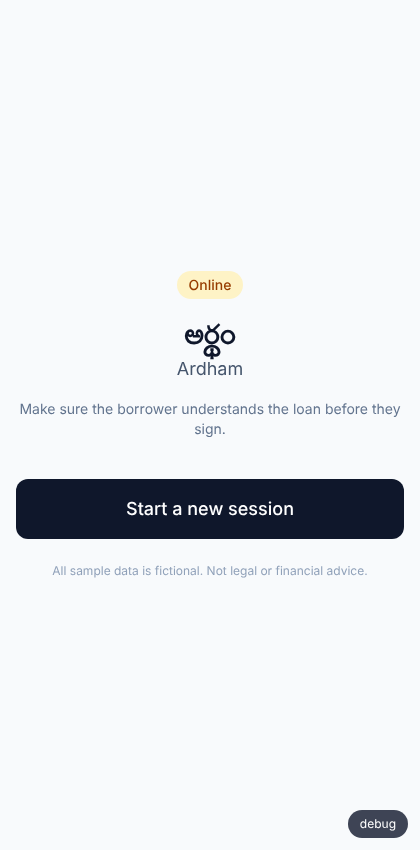
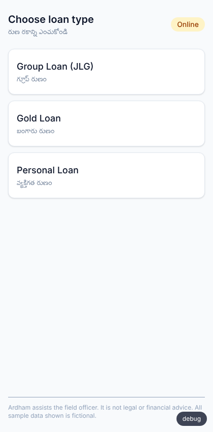
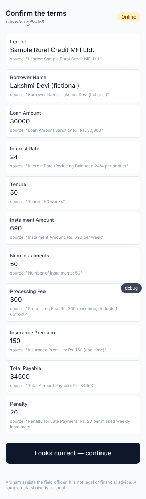
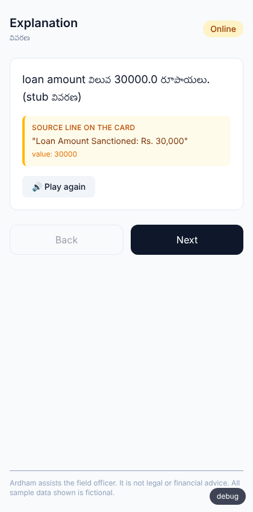
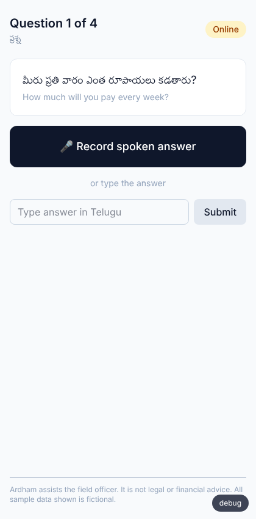
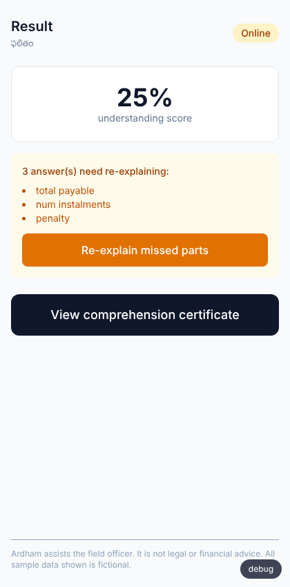
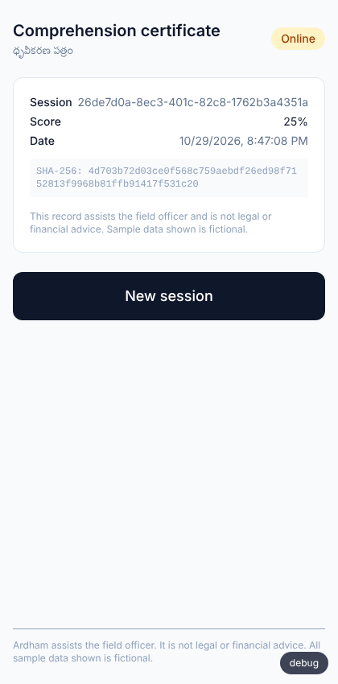
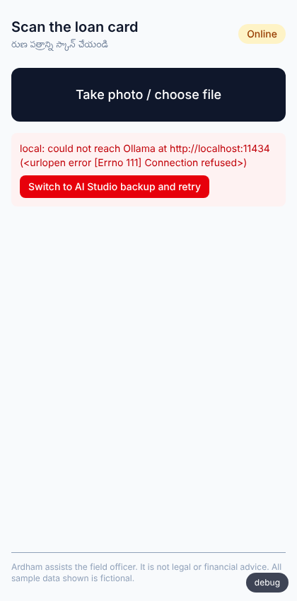
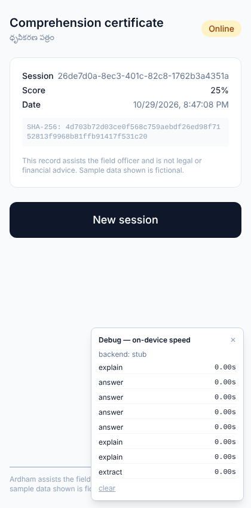

# Ardham (అర్థం)

> Make sure a borrower understands a loan before they sign it — offline, in Telugu, on Gemma 4.

Built solo for **Hacktoberfest Hack Day Vizag x AI for Vizag (MLH)**. Targeting
**Best Use of Gemma 4** (primary) and **Best Open-Source AI Project** (secondary).

| | | |
|---|---|---|
|  |  |  |
|  |  |  |
|  |  |  |

*Screenshots are from a real browser run against the real backend — see
`docs/SPIKE_RESULTS.md` for how. The explanation text in them comes from
`StubGemma`, a non-Gemma stand-in used only because this build environment
has no path to a real model (see below); the Telugu sentence literally says
"(stub వివరణ)" so it's self-evident, not passed off as real output.*

> **What's actually verified, honestly:** every screen (scan → review → explain with
> source highlighting → quiz → targeted re-explain → certificate), the hallucination
> guard, the debug panel, and the one-click backend-switch-on-error UI were driven
> end-to-end in a real browser against the real FastAPI backend — see
> `docs/SPIKE_RESULTS.md` for how and the screenshots that prove it. What has **not**
> been verified anywhere is real Gemma 4 output quality — this build environment has
> no GPU and no network path to Ollama, so extraction accuracy, Telugu explanation
> quality, and audio understanding all still need a real run on your laptop before
> the actual demo. `ARDHAM_RUN_LIVE_TESTS=1 pytest` is how you do that.

## The problem

Rural microfinance and small-loan borrowers often sign loan papers they can't fully
read — interest rate, instalments, fees, penalties. RBI's Key Fact Statement rules
require lenders to explain loans in a language the borrower understands, and lenders'
own Fair Practices Codes promise "training to explain them the terms and conditions
of the loan." Today that's a field officer talking and the borrower signing. **There's
no proof the borrower understood** — which leads to mis-selling complaints, disputes,
regulatory risk, and bad loans.

## The solution

1. **Scan** a photo of the loan card or Key Fact Statement.
2. **Explain** each term aloud in Telugu, Gemma 4 quoting the exact clause it came
   from so it never invents a number.
3. **Check** understanding with 3–4 simple spoken or typed questions.
4. **Grade and re-explain** only the parts the borrower got wrong — the re-explain
   step regenerates just those fields, not the whole explanation again.
5. **Prove it** with a comprehension certificate — terms, questions, answers, score,
   timestamp, and a SHA-256 hash — kept for audits and disputes.

Everything runs **fully offline, on-device**, because villages have weak network and
loan data is too sensitive for the cloud.

## How Gemma 4 is used

| Gemma 4 ability | Used for | Where in the code |
|---|---|---|
| Vision | Reading the photographed loan card into structured fields | `backend/extract.py` |
| Multilingual | Explaining every term in simple, spoken Telugu | `backend/explain.py` |
| Audio input | Understanding the borrower's spoken answers | `backend/main.py` (`/sessions/{id}/answer`) |
| Function calling / structured output | Grading answers, extraction schema | `backend/quiz.py`, `backend/extract.py` |
| On-device (Gemma 4 E4B, ~2.5GB) | All of the above with Wi-Fi off | `backend/model_client.py` (`LocalGemma`) |

A Google AI Studio backend (`AIStudioGemma`) is wired in as a backup, switched with
one environment variable — never a different model, just a different place to run
the same Gemma 4.

## The hallucination guard

`backend/guard.py` is the differentiator. It does three things, none of which trust
the model's own claim of accuracy:

1. **`check_consistency(terms)`** — recomputes derived values in plain code (e.g.
   instalment × number of instalments vs. the stated total payable) and flags any
   mismatch for the officer to see, before any explanation is generated.
2. **`validate_sentence(sentence, terms)`** — every number in a generated Telugu
   sentence (digits, commas, or spoken-style Telugu numeral words) must match a
   value that was actually extracted from the card, or a simple sum of two such
   values. Anything else is treated as invented.
3. **`filter_explanation(sentences, terms)`** — runs every generated sentence
   through the check above before it ever reaches the frontend; unreferenced or
   invented claims are dropped, not shown to the borrower.

See `backend/tests/test_guard.py` for the specific cases this catches (an invented
number, a mismatched total, a sentence with no traceable field).

## Setup

### macOS / Linux
```bash
git clone <this-repo>
cd ardham
./scripts/setup.sh
./scripts/run_demo.sh
```

### Windows (PowerShell or Command Prompt)
```powershell
git clone <this-repo>
cd ardham
.\scripts\setup.ps1
.\scripts\run_demo.ps1
# Or double-click .\scripts\run_demo.bat
```

This creates the backend virtualenv (`backend/.venv`), installs frontend dependencies (`npm install`), copies `.env.example` to `.env`, and checks for Ollama (`gemma4:e4b`).

Opens the backend on `http://localhost:8000` (docs at `/docs`) and the frontend on `http://localhost:5173`.

### Offline

Once Ollama has `gemma4:e4b` pulled, turn off Wi-Fi — the full scan → explain →
quiz → certificate flow runs entirely on `localhost` against the local model.

### Switching to the AI Studio backup

Two ways, both read the same `ARDHAM_BACKEND` the whole app shares:

- **At startup:** set in `.env` before running `./scripts/run_demo.sh`:
  ```bash
  ARDHAM_BACKEND=aistudio
  GOOGLE_API_KEY=your_key_here
  ```
- **Live, mid-demo, with no restart:** if the local model stops responding, the
  frontend shows a "Switch to AI Studio backup and retry" button on the error
  (wired to `POST /settings/backend`) — click it and the next call to the same
  step just works. This is exactly the "clear error + one-click switch" the
  build plan called for; see `backend/main.py`'s `/settings` routes.

`GOOGLE_API_KEY` still has to be set in the environment before switching live —
the button changes which backend is active, not the credentials.

### Debug panel

A small "debug" button in the bottom-right corner of every screen (see
`frontend/src/components/DebugPanel.tsx`) expands into a live log of per-step
latency (extract/explain/answer) and the currently active backend — exactly what
the build plan asked for so judges can see on-device speed, not just the UI.

## Adding a new loan type or language

Loan types are **Agent Skills** under `skills/<skill-name>/`, following the Agent
Skill Open Standard:

```
skills/<skill-name>/
  SKILL.md          # YAML frontmatter (name, description) + plain-language instructions
  questions.json     # quiz question templates, one per field worth checking
  glossary.te.json   # simple-Telugu term for each field
```

To add a loan type: copy an existing skill folder, rewrite `SKILL.md` for what
matters in that product and its red flags, and update the two JSON files. No backend
code changes required — `backend/skills_loader.py` reads any folder under `skills/`.

To add a language: add a `glossary.<lang-code>.json` alongside the Telugu one, and
extend `backend/explain.py`'s prompt to request that language. (Not yet wired up for
more than Telugu in this build — see Roadmap.)

## Project structure

```
ardham/
  backend/      FastAPI app — model_client, extract, guard, explain, quiz, certificate
                tests/ (pytest, incl. a golden end-to-end test), Dockerfile (optional)
  frontend/     React + Vite + TS + Tailwind PWA
  skills/       Agent Skills, one folder per loan type
  samples/      Fictional sample loan cards + expected extraction JSON + Telugu audio fixtures
  spikes/       Step 0 risk-check scripts (run these before trusting the full app)
  docs/         Architecture, demo script, pitch notes, optional-deploy notes
  scripts/      setup.sh, run_demo.sh
```

## Testing

```bash
cd backend && source .venv/bin/activate
pytest                               # guard + grading unit tests, plus a full
                                       #   scan-to-certificate flow against StubGemma
                                       #   (see below) — all always-on, no model needed
ARDHAM_RUN_LIVE_TESTS=1 pytest        # + extraction accuracy + the SAME full flow
                                       #   against whatever ARDHAM_BACKEND is
                                       #   currently set to — this is the one that
                                       #   actually exercises Gemma 4
```

### What `StubGemma` is (and isn't)

`backend/model_client.py` has a third backend, `ARDHAM_BACKEND=stub`, used only by
`backend/tests/test_e2e_stub.py` and for rehearsing the UI without a live model. It
is **not Gemma** — it returns canned responses matching the bundled sample loan card
so the guard has real numbers to check against. It's deliberately left out of
`GET /settings`'s `available_backends`, so the frontend's backend-switch button can
never select it. Its entire purpose is proving the plumbing (FastAPI routes, SQLite
storage, the guard's number-matching, the certificate, every frontend screen) works
correctly end-to-end independent of whether a real Gemma backend is reachable —
useful in a sandboxed dev environment, and for rehearsing the demo flow before your
laptop has Ollama set up. It says nothing about whether Gemma 4 itself reads loan
cards or understands Telugu well; only `ARDHAM_RUN_LIVE_TESTS=1 pytest` against a
real backend tells you that.

`samples/sample_telugu_answer_{correct,wrong,dontknow}.wav` are synthesized with
`espeak-ng`'s Telugu voice — real Telugu phonemes, good enough to exercise the audio
pipeline end to end, but robotic. Re-record them with a real voice
(`spikes/03_audio_telugu.py` tells you what each one is supposed to say) before
trusting the audio-understanding result for the actual demo.

## Limitations

- **Sample data is entirely fictional** — no real borrower names, amounts, or
  lenders. See `samples/`.
- **Not legal or financial advice.** Ardham assists the field officer; it does not
  replace their judgment or any regulatory process. This is shown in the UI.
- Telugu is the only fully wired language in this build; Hindi/English are fallback
  paths if Telugu audio or TTS isn't available on a given device.
- The hallucination guard catches numbers that don't trace to an extracted field —
  it cannot catch a wrong number that was *already* misread during extraction and
  happens to be internally consistent. `check_consistency` catches some but not all
  of those cases (e.g. a implausible total that still happens to equal instalment ×
  count because both were misread the same way).
- No auth, no cloud database, no multi-officer sync — single local SQLite file, by
  design, for a one-day build.

## Optional: running the backend elsewhere

The demo itself is local/offline by design — but if a lender pilot ever needs the
backend running somewhere other than the officer's own device (e.g. talking to the
AI Studio API instead of on-device Gemma), see `docs/deploy.md` and `backend/Dockerfile`.
Not part of the hackathon demo path; included for the "what comes after the hackathon"
conversation.

## Roadmap

- Android app via LiteRT-LM for true offline mobile deployment
- More Indian languages (Hindi, Odia, Kannada) as additional glossary files
- A lender-side dashboard aggregating comprehension scores across officers/branches
- E-sign integration so the certificate can be attached to the signed loan agreement

## License

Apache-2.0 — see `LICENSE`.
